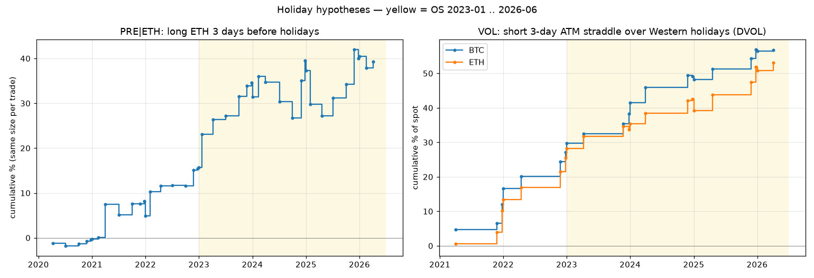

# holiday-crypto-hypo

Hiệu ứng ngày lễ trên hợp đồng perpetual BTC / ETH, chỉ dùng dữ liệu công khai (nến + funding Binance USDT-M,
chỉ số DVOL của Deribit).

## Chạy

```bash
pip install pandas numpy requests matplotlib pyarrow
python holiday_hypo_test.py            # lần đầu tải dữ liệu vào ./holiday_cache (~1 phút)
python holiday_hypo_test.py --refresh  # tải lại dữ liệu
```

## Kiểm định cái gì

| Phần | Luật |
|------|------|
| Đo lường | volume, biến động thực (từ nến 1h), biên độ ngày vào dịp lễ so với cùng thứ trong 8 tuần trước |
| PRE\|ETH | long ETH perp từ giá đóng cửa D-4 đến D-1, 7 ngày lễ mỗi năm (phí 16 bp + funding) |
| VOL | bán straddle ATM 3 ngày lúc 00:00 UTC vào Giáng sinh, Năm mới, Phục sinh (Thứ Sáu Tuần Thánh), Lễ Tạ ơn, định giá theo DVOL |

Ngày lễ: Giáng sinh, Năm mới, Lễ Tạ ơn (Mỹ), Phục sinh, Tết Nguyên đán, Quốc khánh Mỹ 4/7, Quốc khánh Trung Quốc 1/10.
Giai đoạn: IS 2020-02 .. 2022-12, OS 2023-01 .. 2026-06.

## Kết quả (từ script)

| | IS | OS |
|---|---|---|
| Lễ phương Tây: biến động thực so với ngày thường | 0.70-0.82 | 0.45-0.68 |
| Lễ châu Á: biến động thực so với ngày thường | 0.74-1.01 | 1.25-2.17 |
| PRE\|ETH | 19 lệnh, thắng 74%, +0.81% | 24 lệnh, thắng 62%, +0.99% |
| VOL BTC (định giá theo DVOL) | 7 lệnh, thắng 100%, +3.9% giá spot | 14 lệnh, thắng 79%, +2.1% |
| VOL ETH (định giá theo DVOL) | 7 lệnh, thắng 100%, +3.6% | 14 lệnh, thắng 79%, +2.0% |

## Trong repo còn có

| Thư mục | Nội dung |
|---|---|
| [btc-pump-leaders](btc-pump-leaders/README.md) | long coin có volume bùng nổ, gần đỉnh, vào ngày BTC tăng mạnh: luật do mining tìm ra + bản tối ưu, IS + OS, đường PnL, [vì sao bắt được](btc-pump-leaders/mechanism.md) |
| [pump-short-alphas](pump-short-alphas/README.md) | 2 luật short coin vừa pump (OI giảm, retail long quá đông), IS + OS; [nguồn gốc](pump-short-alphas/origin.md), [các bản A / A* / B / B*](pump-short-alphas/variants.md) |
| [mined-anomaly-rules](mined-anomaly-rules/README.md) | 7 luật bất thường qua OS từ batch mining 2 (421 luật), nổi bật là 3 luật short (coin mới list bị bơm volume, coin yếu khi BTC mạnh), IS + OS, đường PnL |

## Lưu ý

- Mẫu nhỏ (7-24 sự kiện mỗi giai đoạn); lệnh có hướng không đạt t >= 2.
- DVOL là implied vol 30 ngày. Quyền chọn ngắn hạn qua dịp lễ thường rẻ hơn, nên kết quả VOL là trường hợp tốt nhất:
  edge mất nếu quyền chọn dịp lễ có giá dưới ~45% (BTC) / ~58% (ETH) của DVOL.
- Chỉ để nghiên cứu, không phải lời khuyên đầu tư.


