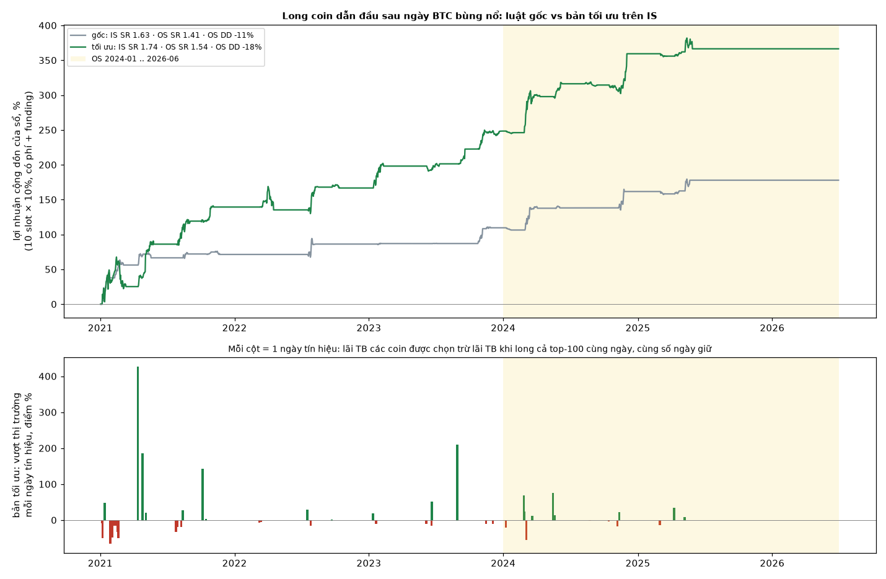

# btc-pump-leaders

Long các coin "dẫn đầu" vào ngày BTC bùng nổ: perp Binance USDT-M, top-100 theo volume 30 ngày (tính tại thời điểm
đó, có cả coin đã delist), phí 16 bp khứ hồi + funding thật.

## Luật

| Bản | Điều kiện trên nến ngày d (đóng 00:00 UTC) | Vào / ra |
|---|---|---|
| **Gốc** (do mining tìm ra) | BTC tăng ≥ 6% trong ngày · coin cách đỉnh 30 ngày ≤ 3.3% · volume ngày z ≥ 2.29 so với 30 ngày trước | long lúc 01:00 UTC ngày d+1, giữ 14 ngày |
| **Tối ưu** (chọn trên IS) | BTC tăng ≥ 5% · coin cách đỉnh 30 ngày ≤ 10% · volume z ≥ 2.7 | long 01:00 UTC d+1, giữ 21 ngày, không stop |

Mỗi coin chỉ có 1 lệnh mở một lúc. Sổ gồm 10 slot, mỗi lệnh 10% vốn (lệnh thứ 11 trở đi chia đều), phần còn lại để tiền mặt.

## Kết quả

IS 2021-01 .. 2023-12, OS 2024-01 .. 2026-06.

| | Gốc IS | Gốc OS | Tối ưu IS | Tối ưu OS |
|---|---|---|---|---|
| Số lệnh / số ngày tín hiệu | 45 / 19 | 41 / 10 | 122 / 38 | 62 / 15 |
| Thắng (lệnh) | 82% | 81% | 75% | 66% |
| Lãi TB mỗi lệnh | +26.2% | +18.3% | +25.1% | +29.4% |
| Lãi TB mỗi ngày tín hiệu | +27.6% | +5.1% | +39.8% | +13.9% |
| **Vượt "long cả top-100 cùng ngày"** | +21.0% (t 1.6) | **+1.1% (t 0.2)** | +18.9% (t 1.3) | **+9.5% (t 1.1)** |
| Lệnh tệ nhất | −54% | −41% | −46% | −59% |
| Sổ 10 slot: SR / tổng / DD | 1.63 / +110% / −13% | 1.41 / +68% / −11% | 1.74 / +248% / −45% | 1.54 / +118% / −19% |

Hình trên là lợi nhuận cộng dồn của sổ. Hình dưới: mỗi cột là một ngày tín hiệu, cho thấy bản tối ưu thắng hay thua
thị trường bao nhiêu điểm % trong ngày đó.

## Đọc kết quả thế nào

- **Bản gốc gần như chỉ là beta.** Trên OS nó chỉ hơn việc long cả thị trường cùng ngày +1.1%. Phần +18% mỗi lệnh
  đến từ việc altcoin nói chung tăng sau ngày BTC bùng nổ.
- **Bản tối ưu hơn thị trường +9.5% mỗi ngày tín hiệu trên OS**, dương cả năm 2024 lẫn 2025. Nhưng t chỉ khoảng
  1.1, tức chưa có ý nghĩa thống kê.
- **Lãi tập trung.** Ba ngày tốt nhất chiếm khoảng 90% lãi OS: 29/02/2024, 12/11/2024 (sau bầu cử Mỹ), 09/05/2025.
  Từ 06/2025 đến 06/2026 không có tín hiệu nào.
- **Đây là luật theo sự kiện hiếm:** khoảng 13–15 ngày mỗi năm. Sổ để tiền mặt phần lớn thời gian, nên SR của sổ
  trông cao hơn độ chắc chắn thực tế.

## Quy trình (vì sao OS của bản tối ưu không sạch)

| Bước | Dữ liệu dùng | Ghi chú |
|---|---|---|
| 1. Mining | IS | LLM (qwen3:8b) đề xuất luật trong vùng "xu hướng / khoảng cách đỉnh"; luật gốc là 1 trong 7 hit của 300 vòng, 1 trong 2 hit dương cả 3 năm IS |
| 2. OS luật gốc | OS, **1 lần** | đặt tiêu chí trước khi chạy; qua tiêu chí nhưng tỷ lệ SR OS/IS = 0.39 |
| 3. Tối ưu | IS | lưới 7.776 ô (ngưỡng × số ngày giữ × stop × số coin tối thiểu); chọn ô ở giữa vùng ổn định theo phần **vượt thị trường** |
| 4. OS bản tối ưu | OS đã dùng ở bước 2 | **chỉ để tham khảo**; phép thử sạch là chạy paper tiếp |

Lần tối ưu đầu tiên chấm theo lãi thô và chọn phải ô lỏng nhất. Ô đó thực chất là beta altcoin năm 2021, OS chỉ được
+1.4% mỗi ngày tín hiệu. Mình đã bỏ thước đo đó và chuyển sang phần vượt thị trường. Vì quyết định này được đưa ra sau
khi đã nhìn OS, OS của bản tối ưu không được coi là phép thử sạch.

## Vì sao luật bắt được

Xem [mechanism.md](mechanism.md): tách nhóm coin vào những ngày BTC bùng nổ cho thấy edge đến từ **volume bùng
nổ**, không phải từ việc coin đang gần đỉnh.

## File

| File | Nội dung |
|---|---|
| `trades.csv` | từng lệnh: bản, IS/OS, coin, ngày tín hiệu, vào, ra, lãi ròng, lãi khi long cả top-100 cùng ngày |
| `results.json` | mọi số trong bảng trên + bảng tách nhóm |
| `pnl.png` | biểu đồ |

Chỉ để nghiên cứu, không phải lời khuyên đầu tư.

## Related

- [mechanism.md](mechanism.md)
- [../README.md](../README.md)
- [../pump-short-alphas/README.md](../pump-short-alphas/README.md)
