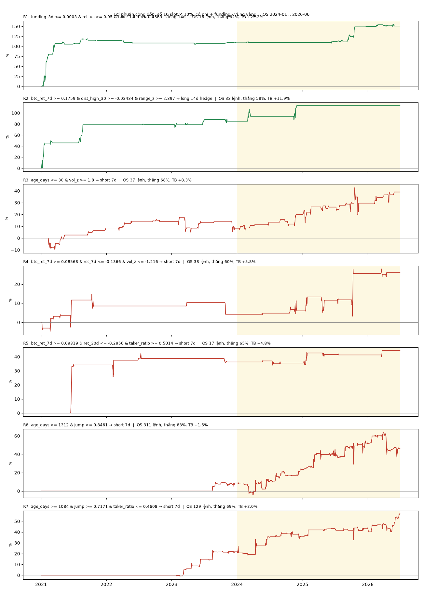

# mined-anomaly-rules

7 luật bất thường do mining tìm ra (LLM qwen3:8b đề xuất, máy chấm trên IS), đã qua OS. Dữ liệu là perp Binance
USDT-M, top-100 theo volume 30 ngày tính tại thời điểm đó (có cả coin đã delist), phí 16 bp khứ hồi + funding thật.

## Cách chọn

| Bước | Dữ liệu | Ghi chú |
|---|---|---|
| 1. Mining | IS 2021-01 .. 2023-12 | 421 luật mới (ngoài 160 luật của batch 1) |
| 2. OS batch 2 | OS 2024-01 .. 2026-06, **1 lần** | đóng băng cả 421 luật, chạy OS một lần |
| 3. Lọc | báo cáo batch | qua IS (≥ 15 lệnh, thắng ≥ 65%, TB ≥ +2%) **và** trên OS ≥ 15 lệnh, thắng ≥ 55%, TB > 0 |

Theo tiêu chí lỏng ở trên, 39/421 luật qua IS, trong đó 9 luật giữ được trên OS. Theo tiêu chí chặt (xem dưới), chỉ 17
luật qua IS và 5 luật giữ được trên OS. 2 luật đã có trong repo nên bỏ qua
([btc-pump-leaders](../btc-pump-leaders/README.md), `retail_crowded_long` trong [pump-short-alphas](../pump-short-alphas/README.md)).
Toàn bộ 39 luật qua IS kèm kết quả OS nằm trong `all_is_hits_batch2.csv`.

## Luật

Tín hiệu lấy trên nến ngày d (đóng 00:00 UTC). Vào lệnh lúc 01:00 UTC ngày d+1, giữ H ngày. Mỗi coin chỉ có 1 lệnh mở
một lúc. "hedge" nghĩa là đồng thời đi ngược BTC với cùng số vốn.

| # | Điều kiện | Lệnh | Qua IS chặt? |
|---|---|---|---|
| R1 | funding TB 3 ngày ≤ 0.03% · tăng ≥ 5% trong phiên Mỹ · taker mua ≤ 45.6% volume | long 14d | không (2022 lỗ) |
| R2 | BTC tăng ≥ 17.6% trong 7 ngày · cách đỉnh 30 ngày ≤ 3.4% · biên độ ngày z ≥ 2.4 | long 14d hedge | không (2022 lỗ) |
| **R3** | perp mới list ≤ 30 ngày · volume ngày z ≥ 1.8 | **short 7d** | **có** |
| **R4** | BTC tăng ≥ 8.6% trong 7 ngày · coin giảm ≥ 13.7% trong 7 ngày · volume z ≤ −1.2 | **short 7d** | **có** |
| **R5** | BTC tăng ≥ 9.3% trong 7 ngày · coin giảm ≥ 29.6% trong 30 ngày · taker mua ≥ 50.1% | **short 7d** | **có** |
| R6 | perp đã list ≥ 1312 ngày · nến 5 phút lớn nhất ≥ 0.85 × biến động ngày | short 7d | không (IS chỉ có 2023) |
| R7 | perp đã list ≥ 1084 ngày · nến 5 phút ≥ 0.72 × biến động ngày · taker mua ≤ 46.1% | short 7d | không (IS chỉ có 2023) |

"Qua IS chặt" là tiêu chí hit của bộ mining: ngoài số lệnh, tỷ lệ thắng, lãi TB, luật còn phải có lệnh trong ≥ 2 năm
IS và năm 2022 (năm giảm) không lỗ. Dữ liệu nến 5 phút (`jump`) chỉ có từ 2023, nên R6/R7 chỉ có 1 năm IS.

## Kết quả

| # | IS lệnh / thắng / TB | OS lệnh (ngày) / thắng / TB / trung vị | OS lãi TB theo năm | OS tệ nhất | Sổ 10 slot OS: SR / tổng / DD |
|---|---|---|---|---|---|
| R1 | 28 / 68% / +39.4% | 16 (15) / 62% / +25.2% / +4.6% | 2024 −9.6 · 2025 +57.6 · 2026 +1.2 | −42% | 1.16 / +40% / −7% |
| R2 | 43 / 65% / +21.2% | 33 (8) / 58% / +12.0% / +3.7% | 2024 +12.0 | −39% | 0.79 / +28% / −19% |
| **R3** | 41 / 73% / +2.1% | 37 (37) / 68% / +8.3% / +13.2% | 2024 +8.9 · 2025 +5.7 · 2026 +13.5 | −54% | 0.69 / +31% / −23% |
| **R4** | 38 / 74% / +2.7% | 38 (20) / 61% / +5.8% / +4.5% | 2024 +1.5 · 2025 +8.9 · 2026 +1.5 | −38% | 0.65 / +22% / −10% |
| **R5** | 33 / 79% / +12.8% | 17 (14) / 65% / +4.8% / +4.6% | 2024 −1.3 · 2025 +6.4 · 2026 +15.9 | −30% | 0.58 / +8% / −3% |
| R6 | 42 / 71% / +2.1% | 311 (113) / 63% / +1.5% / +2.7% | 2024 +1.9 · 2025 +2.2 · 2026 +0.1 | **−165%** | 0.53 / +38% / −28% |
| R7 | 37 / 73% / +5.9% | 129 (61) / 69% / +3.0% / +3.5% | 2024 +3.4 · 2025 +2.5 · 2026 +2.9 | −25% | 0.81 / +35% / −11% |

"ngày" là số ngày có lệnh vào: lệnh cùng ngày thường đi cùng chiều, nên số lần độc lập ít hơn số lệnh.
Sổ 10 slot: mỗi lệnh 10% vốn (lệnh thứ 11 trở đi chia đều), phần còn lại để tiền mặt, không stop.

## Đọc kết quả thế nào

- **Nên tin R3, R4, R5 hơn.** Ba luật short này qua cả tiêu chí IS chặt, có lãi trên OS cả 2024, 2025 và 2026 (R5 lỗ
  nhẹ năm 2024), và lệnh rải trên nhiều ngày.
- **R3: short coin mới list bị bơm volume.** Đây là luật dễ giải thích nhất: coin mới list thường bị xả sau đợt hype.
  Trung vị +13% mỗi lệnh, nhưng lệnh tệ nhất −54% (khi coin bị squeeze).
- **R4 / R5: short coin yếu khi BTC đang mạnh.** Coin không bám được nhịp tăng của thị trường thì thường giảm tiếp.
- **R1 và R2 là luật long theo nhịp tăng.** Lãi IS đến gần hết từ năm 2021. Lãi OS của R1 đến từ năm 2025, còn R2
  chỉ có 8 ngày vào lệnh và tất cả trong năm 2024.
- **R6 lãi mỏng và có rủi ro đuôi.** Lệnh tệ nhất −165% là một lần short bị squeeze. Không nên chạy luật này nếu
  không có stop.
- **Trong batch này, bộ lọc IS gần như không có tác dụng.** Tương quan xếp hạng IS–OS chỉ 0.08. OS SR trung vị của 17
  luật qua IS chặt là −0.05, ngang với −0.07 của các luật còn lại. Ở batch 1 thì khác: 0.38 so với 0.09. Vì vậy 3 luật
  R3–R5 cũng có thể chỉ là phần may của 17 lần thử. Phép thử sạch là chạy paper tiếp.

## File

| File | Nội dung |
|---|---|
| `trades.csv` | từng lệnh: số luật, IS/OS, coin, giờ vào, giờ ra, lãi ròng (đã có phí, funding, hedge) |
| `results.json` | mọi số trong bảng trên + điều kiện gốc của luật (`spec`) |
| `all_is_hits_batch2.csv` | 39 luật qua IS của batch 2, kết quả IS và OS |
| `pnl.png` | biểu đồ |

Chỉ để nghiên cứu, không phải lời khuyên đầu tư.
