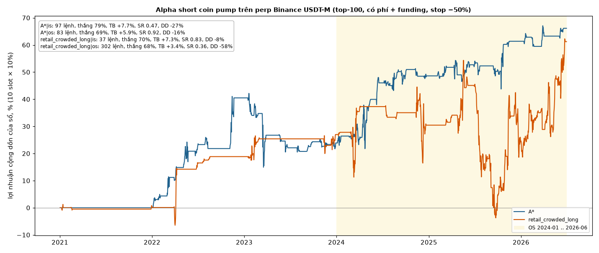

# pump-short-alphas

Two short rules on Binance USDT-M perps that survived an out-of-sample run, from a separate mining project
(not holiday related). Both fade a pump that is not backed by fresh positioning.

| Doc | What |
|---|---|
| [origin](origin.md) | where each idea came from (LLM mining / hand-written seed) and where the anomaly is |
| [variants](variants.md) | all versions A / A* / B / B*, and both alphas on top-30 vs smaller coins |

## Rules

| Alpha | Signal on the daily bar d (UTC) | Trade |
|---|---|---|
| A* (OI-drop pump) | open interest 7-d change ≤ −25% and 1-d return ≥ +13% and 30-d std of daily returns ≤ 0.12 | short 10 days |
| retail_crowded_long | global long/short account ratio z-score ≥ 1.806 and 7-d return ≥ +24.95% | short 7 days |

| Item | Value |
|---|---|
| Universe | top-100 perps by 30-d $ volume, point in time, delisted coins included |
| Entry / exit | 1h close at 01:00 UTC on d+1, exit after the hold |
| Costs | 16 bp round trip + funding paid / received |
| Stop | exit at the first daily mark at a −50% loss (A*: daily close ≥ entry × 1.5) |
| Overlap | one open trade per coin per rule |
| Book | 10 slots of 10% (1/n when more than 10 are open), cash otherwise |
| Data | Binance klines, funding and `metrics` (OI, long/short ratio) from data.binance.vision; OI / ratio exist for alts only from 2021-12 |

## Results

IS 2021-01 .. 2023-12, OS 2024-01 .. 2026-06. Per-trade net after costs and funding; SR and drawdown of the 10-slot book.

| Alpha | IS trades · win · mean · SR · DD | OS trades · win · mean · SR · DD |
|---|---|---|
| A* | 97 · 79% · +7.7% · 0.47 · −27% | 83 · 69% · +5.9% · 0.92 · −16% |
| retail_crowded_long | 37 · 70% · +7.3% · 0.83 · −8% | 302 · 68% · +3.4% · 0.36 · −58% |

By BTC regime (trend = BTC 30-d return sign, vol = BTC 30-d vol vs its 365-d median), OS mean per trade:

| Alpha | bull·calm | bull·vol | bear·calm | bear·vol |
|---|---|---|---|---|
| A* | 11 · +0.7% | 22 · +3.4% | 8 · +3.4% | 42 · 81% win · +9.0% |
| retail_crowded_long | 108 · +4.8% | 112 · +2.7% | 34 · −1.8% | 48 · 81% win · +5.6% |

Files: `trades.csv` (every trade: alpha, segment, symbol, entry, exit, BTC regime, net), `results.json`.

## Caveats

| Caveat | Effect |
|---|---|
| Selection | retail_crowded_long was 1 of 17 IS hits kept by the OS; A*'s parameters were tuned after its OS had been seen once. The OS is not a clean holdout |
| Stop gaps | the stop is checked at daily marks, so a single trade can still lose > 50% (worst OS trade −124%) |
| Short pumps | many losers spike far above entry before collapsing; tighter stops turned the OS mean negative |
| Regime | bear·vol looks best for both, but that was seen only after the OS: not a rule |
| Forward test | a forward paper book of both rules started on 2026-10-23 |

Research only, not investment advice.

## Related

- [origin](origin.md) · [variants](variants.md)
- [holiday test](../README.md)
