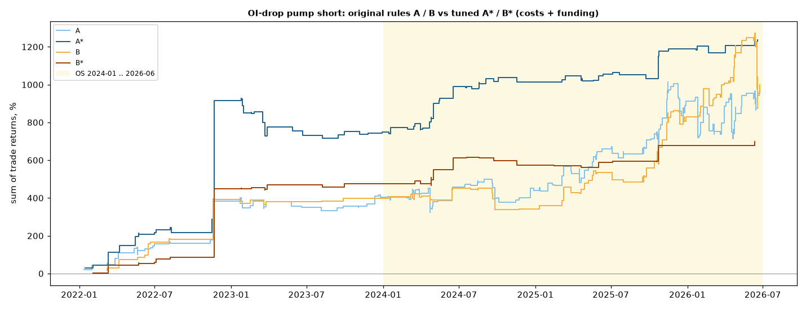

# variants

All versions of the OI-drop pump short, and both alphas by coin size. IS 2021-01 .. 2023-12 (OI data for alts starts
2021-12, so trades start in 2022), OS 2024-01 .. 2026-06. Costs 16 bp round trip + funding.

## A / A* / B / B*

| Version | Rule (short) | Hold · hedge · stop · vol filter |
|---|---|---|
| A (mined) | OI 7d ≤ −25% & ret 1d ≥ +13% | 7d · BTC hedge · none · none |
| B (mined) | OI 7d ≤ −30% & ret 1d ≥ +15% | 7d · none · none · none |
| A* (tuned) | OI 7d ≤ −25% & ret 1d ≥ +13% | 10d · none · daily close ≥ entry × 1.5 · σ30 ≤ 0.12 |
| B* (tuned) | OI 7d ≤ −30% & ret 1d ≥ +13% | 10d · none · daily close ≥ entry × 1.5 · σ30 ≤ 0.10 |

| Version | IS trades · win · mean · worst · SR | OS trades · win · mean · worst · SR |
|---|---|---|
| A | 114 · 71% · +3.6% · −36% · 0.89 | 213 · 58% · +2.6% · −216% · 0.31 |
| B | 56 · 79% · +7.1% · −24% · 1.08 | 111 · 63% · +5.4% · −248% · 0.46 |
| A* | 97 · 79% · +7.7% · −58% · 0.75 | 83 · 69% · +5.9% · −34% · 1.02 |
| B* | 52 · 89% · +9.1% · −13% · 0.69 | 34 · 71% · +6.6% · −25% · 0.57 |

SR here = equal-weight book of open trades (as in the tuning script); the 10-slot book in the README gives A* 0.47 / 0.92.
A and B were frozen before their OS run. A* and B* were tuned with the OS already seen: their OS is in-sample for the
tuning, only the forward paper (from 2026-10-23) is clean. A* by year: 2022 +12.9%, 2023 −6.4%, 2024 +5.6%,
2025 +6.0%, 2026 H1 +8.0% per trade.

The chart sums trade returns (not a sized book). The jump in Nov 2022 is the FTX crash: many signals at once, a
large share of the IS profit comes from that one cluster.

Files: `variants_trades.csv` (variant, segment, symbol, entry, exit, stopped, net), `variants.json`.

## By coin size (top-30 vs rank 31-100)

Same rules, -50% stop and 10-slot book as the README, universe split by 30-d $ volume rank (point in time).

| Alpha · universe | IS trades · win · mean · SR | OS trades · win · mean · SR · DD |
|---|---|---|
| A* · top-30 | 33 · 67% · +4.0% · 0.28 | 22 · 68% · +6.3% · 0.63 · −8% |
| A* · rank 31-100 | 64 · 86% · +9.7% · 0.78 | 61 · 69% · +5.7% · 0.79 · −15% |
| retail · top-30 | 13 · 85% · +9.6% · 0.79 | 79 · 61% · +2.3% · 0.35 · −31% |
| retail · rank 31-100 | 24 · 62% · +6.1% · 0.62 | 226 · 71% · +4.0% · 0.49 · −47% |

Both hold on the 30 largest perps too, with fewer trades: the edge is not only a small-cap effect.

## Related

- [README](README.md)
- [origin](origin.md)
